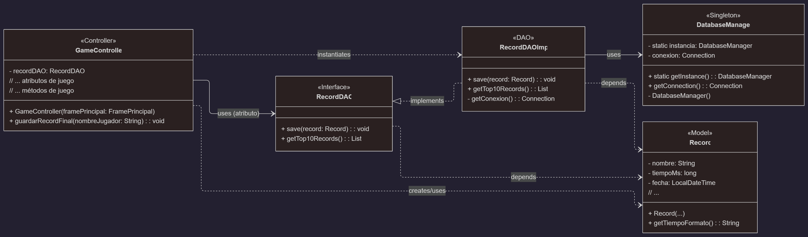
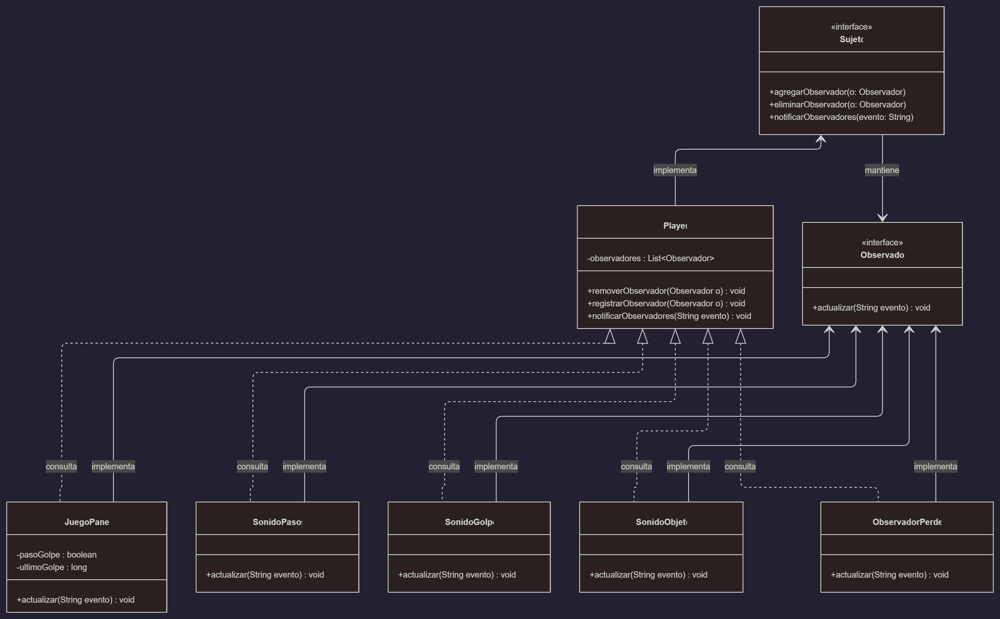
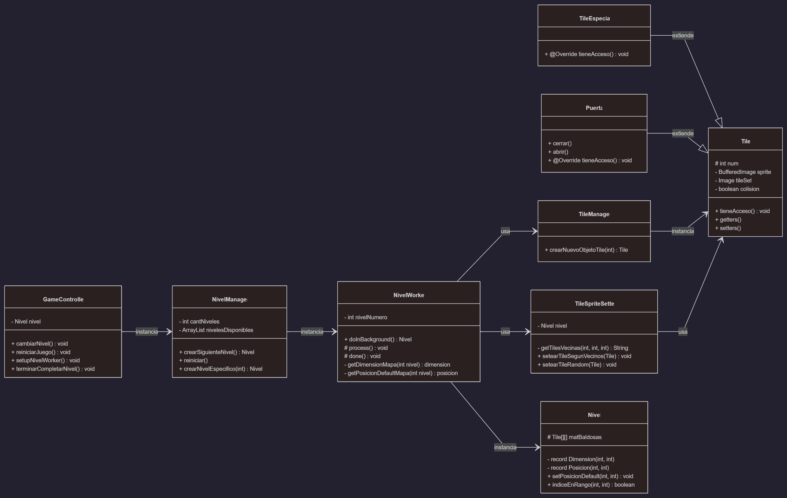
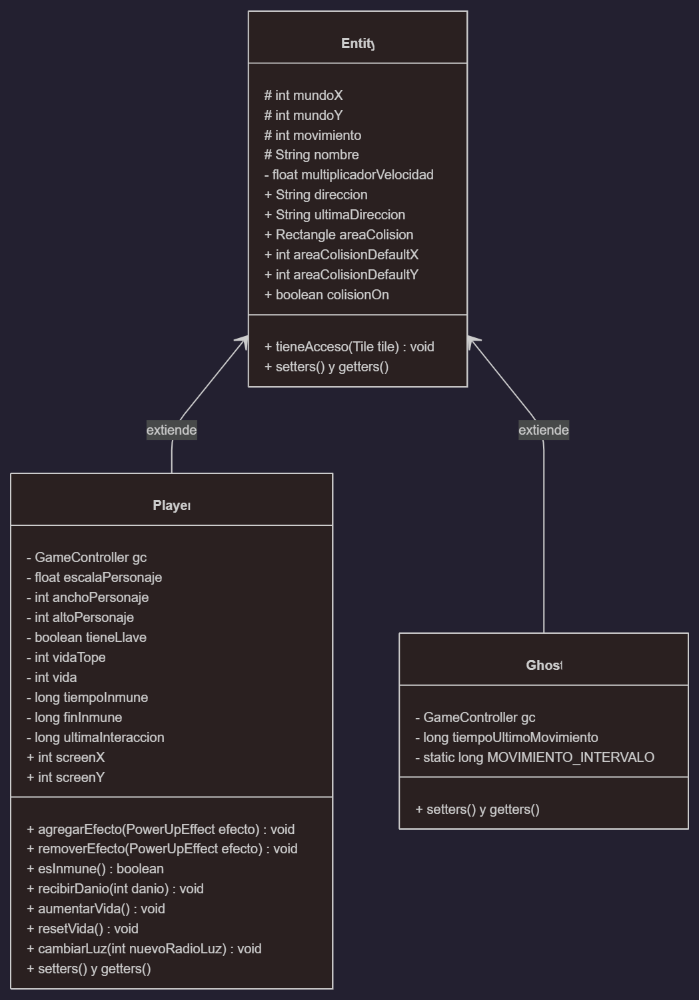
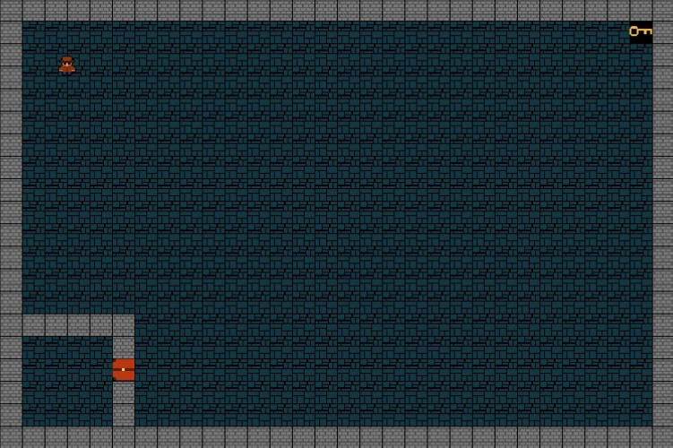
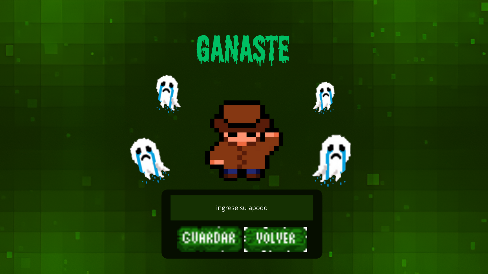
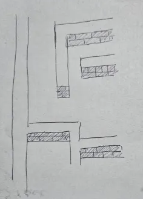
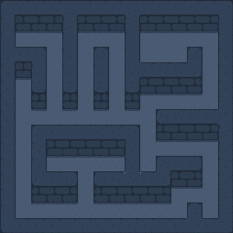
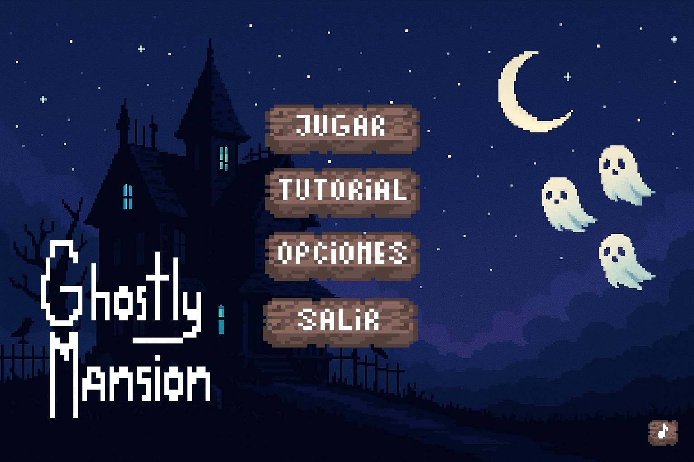

# Trabajo Final
# Proyecto: Ghostly Mansion

## 1. Integrantes del Equipo 

- Pizzonia, Carolina Belen.
- Ruiz, Lucas.
- Segurado, Matias.  
- Verdasco, Ana Victoria.

## 2. Dominio y Alcance del Sistema 

### Descripción del Problema
Se busca desarrollar un juego de escritorio tipo laberinto con temática de terror. El jugador se genera con visibilidad reducida en una ubicación de un laberinto, y debe buscar una llave para abrir una sala de escape donde se completa el nivel y se avanza hacia el siguiente a través de una escalera. Para realizar esto, se debe evitar diversos fantasmas los cuales en caso de entrar en contacto provocarán una pérdida de vida o de la partida, para ello el jugador contará con habilidades temporales distribuidas a lo largo del mapa(aumento de visión, rapidez). Para ganar debe completar los tres niveles que representan los pisos de la mansión fantasmal (Ghostly Mansion).

### Objetivo del Sistema
Entregar un juego funcional y escalable, el cual permita experimentar las mecánicas de **Survival and Horror**. El diseño será modular para facilitar la adición de nuevos niveles, texturas, habilidades del jugador, radios de visión, movimiento y habilidades de los fantasmas. Esto se realizará aplicando los cuatro pilares claves de la materia (encapsulamiento, abstracción, herencia y polimorfismo) y tratando de respetar los principios SOLID lo más posible(responsabilidad única, principio de abierto/cerrado, sustitución de Liskov, segregación de interfaces e Inversión de dependencia), lo que facilitará la depuración y extensión del código.

### Funcionalidades Principales (Features)
    
#### **Mapa:**
    - Los mapas se seleccionarán de manera aleatoria de una pileta de mapas por cada nivel.
    -   Los mapas incluyen: 
            - Sala de escape con su respectiva escalera para pasar de nivel.
            - Puerta en la sala de escape. 
            - Llave en una posicion en el mapa seleccionada aleatoriamente entre posiciones predeterminadas.
            - Diversos fantasmas que se mueven a través del laberinto.
            - Paredes y caminos del laberinto.
            - Jugador con un punto de aparición predefinido.
            - PowerUps para el jugador (rapidez, visión ampliada, añadir vida) que aparecen aleatoriamente entre posiciones predeterminadas.

#### **Fantasmas:**
    - Se irán moviendo a lo largo del mapa, con una logica de movimiento sencilla (cambia aleatoriamente de dirección al colisionar con una pared del laberinto).
    - Le reducen una vida al jugador al entrar en contacto. 
    - No atraviesan paredes.

#### **Jugador**
    - Posee movimiento en eje X e Y con una velocidad base.
    - Obtiene inmunidad temporal luego de ser dañado.
    - Tiene 3 vidas base.
    - Tiene colisión con entidades solidas.

#### **PowerUps**
    Existen 3 powerups que aplican su mecánica al momento de entrar en contacto.
    - Vision Ampliada: Amplía el radio de la visión reducida temporalmente.
    - Rapidez: Multiplica la velocidad del jugador temporalmente.
    - Añadir Vida: Le añade una vida al jugador.

#### **Mecánicas de Juego:**
    - Visión reducida, un círculo de radio R visible (este valor cambiará dependiendo de si el jugador activa el powerup de vision ampliada o no). No tiene visión fuera de este círculo.  
    - El jugador tiene un número de vidas, que disminuyen si un fantasma entra en contacto con él, y aumenta si el jugador tiene contacto con el PowerUp de añadir vida. El juego termina si las vidas llegan a cero.
    - Si el jugador tiene la llave, al momento de colisionar con la puerta la abre. Si no, esta permanece cerrada. 
    - Se puede jugar el tutorial, un laberinto (15x15) fijo para explicar mecánicas.
    - En la tabla de puntaje se muestran los jugadores ordenados descendentemente según cuánto tardaron en completar el juego.

#### **Interfaz Gráfica (IGU):**
    - Pantallas: Usuario, Menú, Juego, Pausa, Perder, Ganar, Puntaje.
    - Visualización del laberinto, personaje, PowerUps, llave y enemigos.
    - En el juego
        - Timer que muestra arriba a la derecha cuánto tiempo se lleva de partida.
        - Corazones arriba a la izquierda que corresponden con la cantidad de corazones que tiene el jugador.
    - Botones:
        - Menú: Jugar, Tutorial, Records, Salir, activar/desactivar volumen.
        - Juego: Pausa.
        - Pausa: Continuar, Reiniciar, Menú Principal.
        - Ganar: Guardar Usuario, Volver al Menú.
        - Perder: Volver al Menú, Reiniciar Partida.

#### **Persistencia:**
    - Sistema de guardado y carga de los tiempos más bajos en completar los niveles (Records) en una base de datos.
### Como el usuario puede iniciar la base de datos local ?
- Para iniciar la base de datos es necesario dirigirse a la clase DatabaseManager y ubicar la línea 18. Allí, en la variable private static final String PASSWORD = "", se debe colocar la contraseña personal de PostgreSQL entre comillas. Además, es fundamental verificar que el proyecto incluya la librería correspondiente para que el programa pueda conectarse a PostgreSQL y asi hacer funcionar la base de datos.

## 3. Arquitectura y Diseño 

### Patrón MVC 
- Nuestro proyecto usa MVC en el menú y en el juego por separado, y los une mediante un ControladorPrincipal que coordina todo desde el FramePrincipal. Esto permite mantener la lógica de cada parte independiente y cambiar entre pantallas sin abrir nuevas ventanas.

### Patrón Singleton
- El Patrón Singleton es utilizado en la clase **DatabaseManager** para la conexion a la base de datos, con el objetivo de mantener una única instancia activa durante toda la ejecución de la aplicacion, garantizando un uso eficiente de los recursos, evitando la creación repetida de conexiones, reduciendo la sobrecarga y manteniendo la coherencia en el acceso a los datos. 

### Patrón DAO 
- Se utiliza el patrón DAO (Data Access Object) para gestionar de manera limpia la conexión a la base de datos PostgreSQL, las operaciones de guardado y lectura de récords. La clase **Record** actúa como el modelo de datos, refleja la estructura de una fila en la tabla récords de la base de datos (jugador y tiempo). La interfaz **RecordDAO** define las operaciones de acceso a datos relacionadas con los récords. La clase **RecordDAOImpl** es la implementacion concreta de la interfaz **RecordDAO**, su proposito es ejecutar las consultas SQL reales para satisfacer los métodos definidos en la interfaz **RecordDAO**, además utiliza la clase **DatabaseManager** a través del método `getConexion()` para obtener y usar la conexión única a la BD.

### Patrón de Diseño Adicional: Command
- **Nombre del Patrón: Command (Comando)**
- **Justificación:** Se utilizará este patrón para manejar los efectos de los PowerUps, ya que no todos los Objetos tienen efectos temporales. De esta manera **desacoplamos** cada uno de los Objetos de sus efectos, cómo se implementan, y cómo removerlos. 
  El GameController interactúa únicamente con los Objetos y los PowerUpEffects, sin saber cuáles son, ni cómo se aplican ni remueven. Esto logra **encapsulamiento** y hace uso del **polimorfismo dinámico**.
- **Elementos:**
    - Clase Abstracta *Command*, en nuestro caso `PowerUpEffect`, que declara el contrato *execute()* y *remove()*, `void aplicar(Player)` y `void remover(Player)`, que se encargarán de pedirle al jugador de que los aplique y remueva.
    - *Concrete Commands*, `AmpliarVisionEffect` y `RapidezEffect`, que implementan `void aplicar(Player)` y `void remover(Player)`
    - *Receiver (Recibidor)*, en nuestro caso `Player`, que recibirá la solicitud pedida dentro de los métodos `remover(Player)` y `aplicar(Player)`, y los ejecutará como sea necesario.
    - *Client (Cliente)*, cada uno de los `Objetos` que tienen `PowerUpEffects`, que son `Rapidez` y `AmpliarVision`, que se encargan de crear las instancias de los comandos concretos, los PowerUpEffects, y les pasa la instancia de Receiver, el `Player`
    - *Invoker (Invocador)*, en nuestro caso `GameController`, que guarda las referencias a los efectos concretos e inicia las acciones según necesario.

### Patrón de Diseño Adicional: Patron Observer
- **Nombre del Patrón:** **Observer**.
- **Justificación:** Este patrón se utilizará para manejar los *efectos de sonido y visuales* del juego. El objetivo fue desacoplar la lógica del jugador (que genera los eventos) de los efectos que se reproducen (los observadores).
- **Elementos:**
    - Interfaz *Sujeto (Observable)*, es el que genera los eventos. *Player* implementa la interfaz Sujeto, porque es quien notifica cuando algo pasa. Los métodos principales del sujeto: `void registrarObservador(Observador o)` que permite agregar un observador, `void removerObservador(Observador o)` que remueve un cierto observador, y `void notificarObservadores(String evento)` que avisa a todos los observadores que algo ocurrió.
    - Interfaz *Observador (Observer)*, que define el método que reaccionará a las notificaciones. 
    - Las clases *SonidoPasos, SonidoGolpe, SonidoObjeto, ObservadorPerder* implementan la interfaz *Observador* y sobrescriben el método `void actualizar(String evento)`, que redefine que hacer al recibir una notificación (en nuestro caso, reproducir un sonido específico o mostrar la pantalla de perder, dependiendo de el evento ocurrido).
    - *Player* mantiene una lista de Observadores (List<Observador> observadores), y cuando el jugador hace algo (por ejemplo, moverse), llama a `notificarObservadores("MOVIENDOSE")` y todos los observadores reciben el mensaje y actúan según su tipo.
    - *Evento* --> Es el mensaje que el *Sujeto* envía a los *Observadores*. En nuestro caso, es un String, que indica que acción ocurrió. Por ejemplo, cuando en el `GameController` hay una colisión entre un objeto y el jugador, se llama a `jugador.notificarObservadores("AGARRAR_OBJETO")`.
    - El panel del juego también actúa como Observador, de manera tal que, Player lo notifica cuando ocurre un evento. Cuando esto pasa, el metodo `actualizar()` se ejecuta y si la String que ingresa es 'GOLPE' se cambia el estado de la flag pasoGolpe a true, y activa la animación.
    -El ObservadorPerder instancia al gamecontroller. De esta manera, cuando el jugador notifica el evento "JUGADOR_PERDIO", el juego automáticamente frene el juego y muestra la pantalla de perder.

## **Diagrama de Clases UML (Conceptual)**

### **Base de datos**

Este es el UML que corresponde a la base de datos

### Observer

Este es el UML que correspone al patron explicado arriba.

### Niveles

En este UML se puede observar como todo parte de una clase **Tile** que representa las baldosas, junto con sus sprites, colision, y un método *tieneAcceso()* que le pregunta a la baldosa si la entidad tiene acceso o no. De esta clase <heredan> **Puerta** y **TileEspecial**, quienes sobreescriben *tieneAcceso()* según lo necesitan para su correcto funcionamiento. 
Luego, **TileManager** se encarga de instanciar cada objeto Tile según cómo le pida el **NivelWorker**, e iniciarlizarl su colisión.
**TileSpriteSetter** setea las sprites de las tiles según distintos mecanismos, como por según las tiles vecinas que tiene.
**Nivel** es el objeto que contiene la matriz de Tiles de cada mapa. También conoce sus propias dimensiones.
**NivelWorker** es el SwingWorker encargado de instanciar y construir el nivel en otro hilo mientras se muestra una pantalla de carga. Recorre el .txt que tiene la matriz de números del mapa pidiendole a TileManager y TileSpriteSetter que creen y le pongan sprite a las tiles. Notar que ya no interactúa con las tiles individuales, su info y cómo se crean está <encapsulado>.
**NivelManager** se encarga de pedirle el mapa correcto a NivelWorker, para que el jugador no juegue mapas repetidos. NivelManager ya no interactúa con el Nivel, simplemente devuelve una instancia de este.
**GameController** le pide al NivelManager un nivel cuando lo necesita, ya sea por inicio del juego, reinicio, o cambio de nivel. GameController es totalmente ajeno a los mapas y los niveles, y el creación y manejo de ellos y las baldosas está totalmente <abstraído>. Ya que el nivel es una matriz de Tile, se hace uso del <polimorfismo dinámico> porque GameController en ningún momento sabe con qué Tile está tratando.

### Objetos

Estas son las clases que utilizan el patrón **Command**, pero acá nos enfocaremos en los 4 pilares de POO para explicar el esquema.
Se parte de la clase abstracta **Objeto** que tiene el sprite y además establece que todas las clases hijas deben tener un *interactuar(Player)* que devuelve un PowerUpEffect. De esta clase <heredan> los distintos objetos agarrables en el mapa, **Llave, AñadirVida, Rapidez, AmpliarVision** que implementan el *interactuar(Player)*.
Las clases **Rapidez** y **AmpliarVision** tienen efectos temporales, **RapidezEffect** y **AmpliarVisionEffect**, que implementan la clase abstracta **PowerUpEffect** y que se le aplican o remueven al **Player**.
Finalmente el **GameController** solamente interactúa con la lista de Objetos en el mapa, y con la lista de efectos activos del jugador, por lo tanto se trabaja con <polimorfismo dinámico>, ya que se trabaja directamente sobre Objeto y PowerUpEffect. Cómo funcionan los efectos y objetos están <encapsulados>. Se logra <abstracción> ya que el GameController aplica y remueve efectos sin realmente saber cómo se realiza.

### Entidades

Tenemos la clase abstracta **Entity**, que define las propiedades en común (posiciones, direcciones, colisiones) de todas las entidades del juego (en nuestro caso *Player* y *Ghost*); también define el metodo abstracto tieneAcceso(), que después sera redefinido por cada clase hija a su manera. Este método nos va a servir para actuar o no, dependiendo de si la entidad puede atravesar las baldosas o no.
`Ghost` y `Player` *heredan* de `Entity`. Comparten estructura de movimiento y colisión, pero redefiniendo su comportamiento propio:
- *Ghost* --> tiene lógica de movimiento automático. 
- *Player* --> tiene vida, puede acceder a la llave, puede recibir daño y puede interactuar con el entorno.

## Prototipos

## 4. Stack Tecnológico 

- **Lenguaje:** Java 21.0.8 
- **IDE:** Visual Studio Code
- **Base de Datos:** PostgreSQL 18.0 (Para guardar de forma local los 10 mejores tiempos en completar el juego)
- **Framework de IGU:** Java Swing
- **Control de Versiones:** Git y GitHub Classroom

